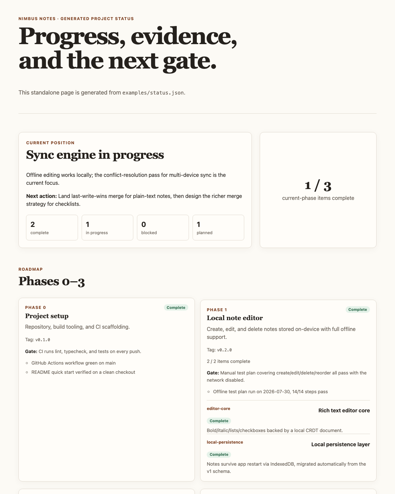

# project-status-page-generator

A single dependency-free Node script that turns a small JSON file describing
your project's phases and status into a static HTML status page — plus a
`--check` mode you can drop into CI so a stale page fails the build instead
of quietly drifting from reality.

## The problem

Project status pages are almost always one of two things: a Notion/Trello
board only the team can see, or a hand-edited `STATUS.md` that nobody
remembers to update after the JSON/tracker it's supposed to summarize
changes. Neither is great when you want a public, linkable "here's where
this project actually is" page that's cheap to keep honest.

This script takes the second approach but removes the "nobody remembers to
update it" failure mode: the HTML is *generated*, never hand-edited, and
`--check` lets CI reject a commit where the source JSON changed but the
generated page wasn't regenerated.

## Quick start

```sh
node generate-status-page.mjs --input status.json --output status.html
```

That's it — no `npm install`, no build step. Point `--input` at a JSON file
shaped like the example below and you get a static HTML page you can host
anywhere (GitHub Pages, a CDN, a repo README link).

**Before**, a `status.json` describing two phases:

```json
{
  "schemaVersion": 1,
  "updated": "2026-08-15",
  "project": { "name": "Nimbus Notes" },
  "current": {
    "headline": "Sync engine in progress",
    "summary": "Offline editing works locally; conflict resolution for sync is the current focus.",
    "nextAction": "Land last-write-wins merge for plain-text notes.",
    "phase": 2
  },
  "phases": [
    {
      "number": 0,
      "title": "Project setup",
      "summary": "Repository, build tooling, and CI scaffolding.",
      "state": "complete",
      "confirmation": "CI runs lint, typecheck, and tests on every push."
    },
    {
      "number": 1,
      "title": "Local note editor",
      "summary": "Create, edit, and delete notes stored on-device.",
      "state": "in_progress",
      "confirmation": "Manual test plan covering create/edit/delete/reorder all pass offline.",
      "items": [
        { "id": "editor-core", "title": "Rich text editor core", "summary": "Bold/italic/lists/checkboxes.", "state": "complete" },
        { "id": "local-persistence", "title": "Local persistence", "summary": "Notes survive an app restart.", "state": "in_progress" }
      ]
    }
  ]
}
```

**After**, running the command above produces a static page with an overview
card (current headline, summary, next action, phase counts), and a roadmap
section listing every phase with its state badge, confirmation gate, and
items. See [`examples/status.json`](./examples/status.json) for a fuller
four-phase example and [`examples/status.html`](./examples/status.html) for
its generated output, committed so you can open it directly in a browser
without running anything.

## The `--check` staleness gate

Add a CI step that runs:

```sh
node generate-status-page.mjs --input status.json --output status.html --check
```

instead of the normal (no `--check`) invocation. In check mode the script
never writes anything — it renders the page in memory and compares it
byte-for-byte against the committed `status.html`. If they differ (including
if `status.html` doesn't exist yet), it exits non-zero with a message telling
you what command to run locally. This catches the common case where someone
edits `status.json` and forgets to regenerate the HTML before committing —
without needing a pre-commit hook or a build pipeline.

Example GitHub Actions step:

```yaml
- run: node generate-status-page.mjs --input status.json --output status.html --check
```

A complete workflow you can copy is in [`docs/status-check.yml`](./docs/status-check.yml).
Exit codes: `0` success or up to date, `1` invalid input or stale page, `2` usage error.
Run `node generate-status-page.mjs --help` for the options.

## Screenshot

The page generated from [`examples/status.json`](./examples/status.json):



## Install as a command (optional)

The script has no dependencies, so copying `generate-status-page.mjs` is enough. A
`package.json` with a `bin` entry is included if you prefer a command name:

```sh
npm install -g github:hyderhusainarastu/project-status-page-generator
project-status-page --help
```

## Use from an AI coding agent

[`AGENTS.md`](./AGENTS.md) is the call contract. Codex, Cursor, Gemini CLI, GitHub Copilot and
Claude Code read it (Claude Code and Gemini CLI through the small `CLAUDE.md` and `GEMINI.md`
pointers; Copilot through `.github/copilot-instructions.md`). The rule it gives an agent: update
`status.json`, regenerate the page, and never hand-edit the HTML. CI `--check` enforces the
regeneration. Pasting `AGENTS.md` into ChatGPT or another chat assistant works the same way.

## JSON shape

The machine-readable version is [`status.schema.json`](./status.schema.json) (JSON Schema).
It cannot express the contiguous-numbering and `current.phase` rules; the script checks those.

- `schemaVersion` — must be `1`.
- `updated` — a date/string shown in the footer.
- `project.name` — shown in the title and header.
- `current` — `headline`, `summary`, `nextAction` (strings), `phase` (the
  number of the phase currently in focus — must match a `phases[].number`).
- `phases` — a non-empty array. Numbers must run `0, 1, 2, …` in order (no
  gaps, no reordering) so the roadmap heading and phase counts stay
  meaningful. Each phase has `title`, `summary`, `confirmation` (the
  done-gate description), `state` (see below), and optionally `tag` (a
  free-text label, e.g. a release tag) and `evidence` (an array of strings
  rendered as a bullet list).
- `phases[].items` — optional. Each item has `id`, `title`, `summary`, and
  `state`.
- Valid `state` values (for both phases and items): `planned`,
  `in_progress`, `blocked`, `complete`.

## Limitations

- No incremental/partial rendering — every run reads the whole JSON file and
  regenerates the whole HTML page from scratch. Fine for the phases-and-items
  scale this is meant for; not meant for huge trackers with thousands of
  items.
- The generated page has no client-side JavaScript and no interactivity
  (no filtering, no collapsing sections). It's a static snapshot, by design.
- `--check` does a literal string comparison of the generated output against
  the file on disk. Any formatting change to the generator itself (even
  whitespace) will make every existing `status.html` register as stale until
  regenerated once — that's expected, not a bug, but worth knowing before
  you wire it into CI.
- There's no schema for nesting phases inside phases, cross-project rollups,
  or a history/changelog view — this generates one page for one project's
  current state, nothing more.
- Styling is fixed (a light/dark-aware built-in theme). If you want a
  different look, edit the `<style>` block in `generate-status-page.mjs`
  directly — there's no separate theming layer.

## Tests

```sh
npm test
```

Runs offline with Node's built-in test runner.

## Related

- [palimnote-tools](https://github.com/hyderhusainarastu/palimnote-tools) — the catalog this tool belongs to.
- [migration-ledger-preflight-gate](https://github.com/hyderhusainarastu/migration-ledger-preflight-gate) — another small CI-style gate for a repo.
- [pnpm-monorepo-ci-template](https://github.com/hyderhusainarastu/pnpm-monorepo-ci-template) — a GitHub Actions workflow template.

Keywords: project status page, static site generator, roadmap, JSON to HTML, CI staleness check, GitHub Pages.

## License

MIT — see [LICENSE](./LICENSE).

Part of palimnote-tools - more at https://github.com/hyderhusainarastu
